# DiyarDesk

**Adaptive desktop wallpaper engine that makes your desktop icons part of the scenery — powered by a zero-WebView2 native Rust + OpenGL 3.3 Core engine.**

[](https://github.com/adam0307a/DiyarDesk/releases/latest)
[](LICENSE)
[](#native-rust--opengl-33-mode-zero-webview2)
[](#included-themes-38-built-in)
[](#quick-install--download)
[](#features)

**English** · [Türkçe](#türkçe) · [Download (v0.5.7)](https://github.com/adam0307a/DiyarDesk/releases/latest) · [Why DiyarDesk?](#why-diyardesk-comparison) · [Rust OpenGL Mode](#native-rust--opengl-33-mode-zero-webview2) · [38 Themes](#included-themes-38-built-in) · [Linux](#linux-setup) · [Windows](#windows-build) · [macOS](#macos-build) · [Android Tablets](#android-tablets-sw600dp)

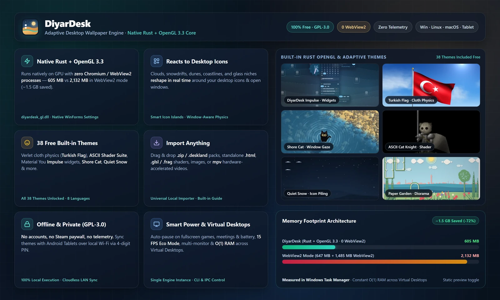

DiyarDesk turns the space around your desktop icons into a living interactive landscape on **Windows**, **Linux** (KDE Plasma 6, GNOME, COSMIC, X11, wlroots Wayland), **macOS**, and **Android Tablets (`sw600dp+`)**. Move, add, or remove an icon and paper-cut arches, snowdrifts, dunes, clouds, aurora glow, AI mascots, or ocean waves reshape smoothly around it — locally in real time, without cloud accounts, paywalls, or telemetry.

> **Upstream attribution:** DiyarDesk is an independent community fork based on [Deskland](https://deskland.app) (`GPL-3.0`), using its own product name (**DiyarDesk**) and original icon, with no official affiliation or endorsement from upstream Deskland. See [NOTICE](NOTICE) and [TRADEMARKS.md](TRADEMARKS.md).

## Quick Install & Download

Download prebuilt installers from **[GitHub Releases (v0.5.7)](https://github.com/adam0307a/DiyarDesk/releases/latest)**:

- **Windows (x64):** `DiyarDesk-*-win-x64-Setup.exe` *(NSIS installer; `winget` package `DiyarDesk.DiyarDesk` submitted at [`microsoft/winget-pkgs#488642`](https://github.com/microsoft/winget-pkgs/pull/488642))*
- **Linux:** `.deb` (Debian/Ubuntu), `.pkg.tar.zst` (Arch), `.rpm` (Fedora/RHEL), or portable `.tar.gz`
- **macOS (Apple Silicon):** `.dmg` desktop app bundle
- **Android Tablets (`sw600dp+`):** `.apk` live wallpaper companion

## Why DiyarDesk? (Comparison)

| Feature | DiyarDesk (Rust OpenGL 3.3) | Wallpaper Engine | Lively Wallpaper |
| --- | --- | --- | --- |
| **Price & License** | **100% Free · GPL-3.0 Open Source** | Paid (Steam) | Free · GPL-3.0 Open Source |
| **Rendering Engine** | **Native Rust + OpenGL 3.3 (`0 WebView2`)** + optional WebView2 | Proprietary + CEF web | WebView2 / Chromium + `mpv` |
| **Typical RAM (built-in themes)** | **~605 MB in Rust GL (`0 WebView2`) vs `2,132 MB` in WebView2 mode (~1.5 GB saved)** | Moderate–High (varies by scene/web) | Higher on WebView2 scenes |
| **Desktop Icon & Window Reaction** | **Yes — real-time Icon Islands & window physics** | No | No |
| **Custom Theme Import** | **Yes** (`.zip`, `.deskland`, `.html`, `.glsl`/`.frag`, image, `mpv` video) | Yes (Editor / Workshop) | Yes |
| **Virtual Desktops Memory Scaling** | **Constant `O(1)`** (single engine instance) | Varies | Varies |
| **Platforms** | **Windows, Linux (KDE/GNOME/Wayland/X11), macOS, Android Tablet** | Windows, Android | Windows |
| **Account / Store / Telemetry** | **None — 100% offline** | Requires Steam | None |

## Live Demo & Gallery


> **Launch Film (v0.5.3):** [Watch / Download 1080p English MP4](https://github.com/adam0307a/DiyarDesk/releases/download/v0.5.3/DiyarDesk-v0.5.3-Launch.mp4) · [Türkçe Tanıtım Videosu (1080p MP4)](https://github.com/adam0307a/DiyarDesk/releases/download/v0.5.3/DiyarDesk-v0.5.3-Launch-TR.mp4)

| Waving Turkish Flag · Cloth Physics (Rust GL) | Shore Cat · Window Gaze (Rust GL) |
| --- | --- |
| 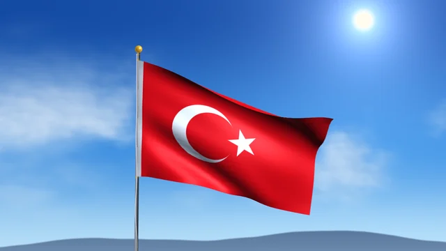 | 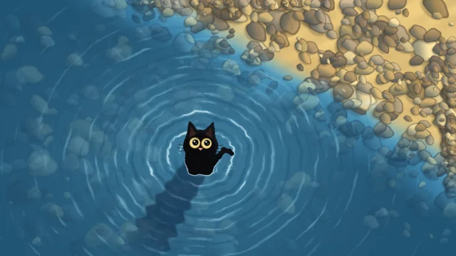 |

| ASCII Cat Knight · Shader (Rust GL) | Cosmic ASCII Eye · OpenGL (Rust GL) |
| --- | --- |
| 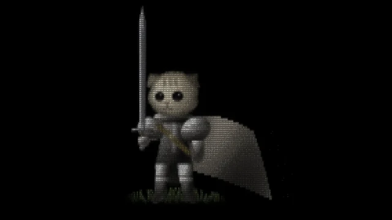 | 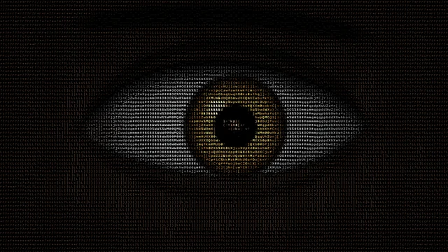 |

| DiyarDesk Impulse · Widgets (Rust GL) | Quiet Snow · Window & Icon Physics |
| --- | --- |
| 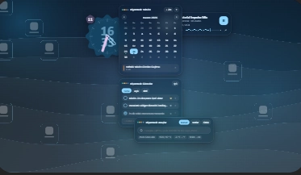 | 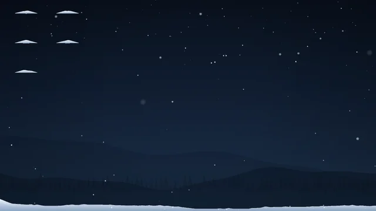 |

<details>
<summary><strong>More demo clips, settings UI & theme gallery</strong></summary>

<br>

[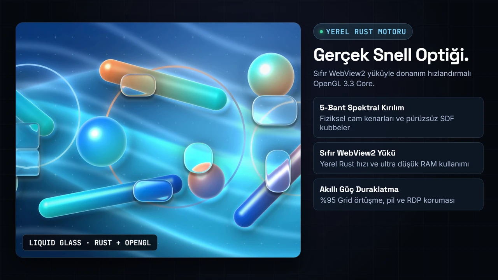](https://github.com/adam0307a/DiyarDesk/releases/download/v0.5.3/DiyarDesk-v0.5.3-Launch-TR.mp4)

https://github.com/user-attachments/assets/692ecb8c-af4a-4183-8e3e-d79dc563a832

https://github.com/user-attachments/assets/0be337c1-53e9-4989-a391-da87cc2528e3

https://github.com/user-attachments/assets/1b5ced02-b424-4204-97c8-ed7ba797de0c

https://github.com/user-attachments/assets/36224867-04a2-4d6a-b534-13024cdc575b


| AI Mascot Lab (Rust OpenGL) | Studio Glass 3D |
| --- | --- |
| 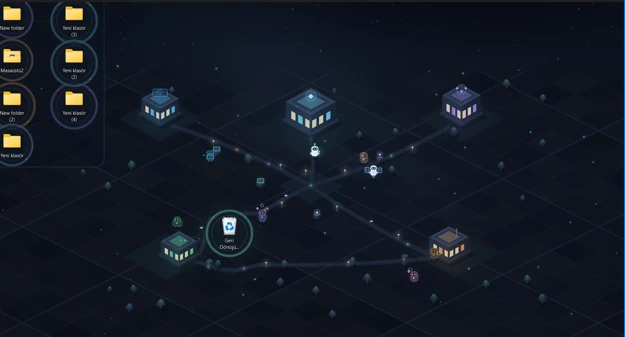 | 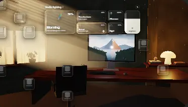 |

| Paper Garden (Katı' Diorama) | Istanbul — Bosphorus Sunset |
| --- | --- |
| 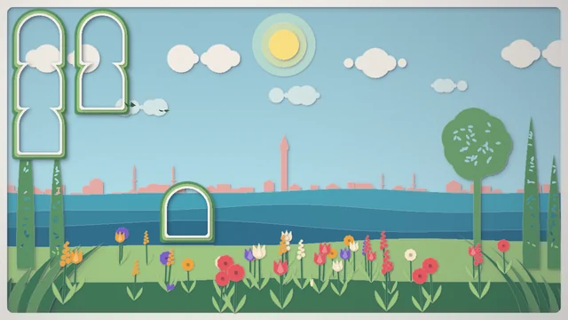 |  |

| Sahara Desert | Polar Night |
| --- | --- |
|  |  |

| Aurora Lake | Meadow & Beach |
| --- | --- |
|  | 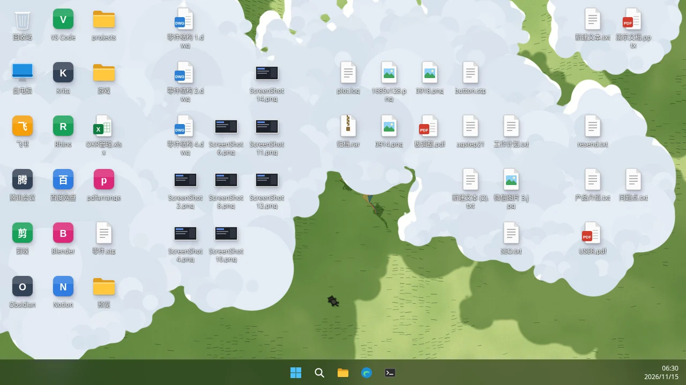 |


</details>

## Native Rust + OpenGL 3.3 Mode (Zero WebView2)

On Windows, DiyarDesk includes a native **Rust + OpenGL 3.3 Core** rendering engine (`native/diyardesk-gl` → `diyardesk_gl.dll`) supporting **all 38 built-in themes**:

- **~1.5 GB less RAM (`605 MB` vs `2,132 MB` total with WebView2):** Enabling **Rust OpenGL** (via the featured performance card in Settings, the system tray menu, or `--ctl rust-gl on`) switches both the wallpaper and Settings UI off WebView2 and deterministically terminates **all** DiyarDesk `msedgewebview2.exe` processes (`0 WebView2`, saving `~1,527 MB` / `~72%` in Windows Task Manager vs WebView2 mode's `647 MB` + `1,485 MB` WebView2).
- **Native Zero-WebView2 Settings UI (`NativeSettingsForm`):** Clean dark/light-aware WinForms interface featuring a **toggleable live Rust OpenGL 3.3 preview** (switch to a static `.webp` preview anytime for even lower memory usage), custom dark sliders & scrollbars, `.webp` theme cards, full parameter editing, and 8-language localization.
- **Constant `O(1)` Virtual Desktop scaling:** A single engine instance persists across all Windows Virtual Desktops without duplicating memory or GPU textures per desktop.
- **One-click WebView2 fallback:** WebView2 support remains intact—click **Switch to WebView2** (or toggle **Rust OpenGL** in the tray) anytime to import custom HTML/ZIP/GLSL/image/video themes or use privacy-safe snapshot/video sharing.

## Included Themes (38 Built-in)

All **38 built-in themes** are free, unlocked, localized in 8 languages, equipped with `.webp` thumbnails, and supported in **Rust OpenGL 3.3** (with HTML5/WebGL parity where applicable):

- **Interactive & Artistic Rust GL:**
  - **Waving Turkish Flag (`turkish-flag`)** — Verlet cloth simulation with golden finial, 4 sky moods (Daylight, Sunset, Starry Night, Auto), and live pointer interaction (hover wake, click ripple + gust, left-click grab & drag)
  - **Shore Cat (`cat-shore`)** — lakeside cat with window-aware gaze and gentle water ripples around icons
  - **Persephone · Silver Engraving (`persephone`)** — engraved silver-on-obsidian atmospheric scene
  - **The Eye Within Words (`eye-within-words`)** — typographic field parting smoothly around a reactive cyan eye
  - **Cosmic ASCII Eye (`cosmic-eye`)** — glowing cosmic iris rendered in layered ASCII typography
- **ASCII Shader Suite (Rust GL):**
  - **ASCII Cat Knight (`ascii-cat-knight`)**, **Clownfish & Anemone (`ascii-clownfish`)**, **Jellyfish Heart (`ascii-jellyfish`)**, **Shark Intercept (`ascii-shark`)**, **Lotus After Rain (`ascii-lotus`)**
- **Widgets & Interactive Labs:**
  - **DiyarDesk Impulse · OpenGL (Rust)** & **DiyarDesk Impulse · Widgets** — Material You frosted glass desktop widgets: 12-petal Cookie hybrid clock, wavy SMTC music player, offline `.ics` calendar, interactive tasks, `/todo` bar & notes
  - **AI Mascot Lab · OpenGL (Rust)** — futuristic night campus with 8 original autonomous AI mascots moving between labs and glowing desktop-icon workstations
  - **Studio Glass** — 3D designer workspace with 5 lighting/weather presets and draggable studio props
- **Atmospheric & Physics:**
  - **Paper Garden (`papercut`)** — default layered paper-cut diorama with Bosphorus skyline, tulips, cypresses, and paper-cut icon niches
  - **Quiet Snow (`quietsnow`)** — snow, rain droplets, autumn leaves, and sakura petals that pile on desktop icons and open window edges
  - **Istanbul — Bosphorus Sunset (`istanbul`)** — animated Bosphorus strait, silhouettes, ferries, and icon piers
  - **Solar System (`solar-system`)** — interactive black hole / star system with orbital icon physics
  - **Liquid Glass (`liquidglass`)**, **Thinking Orbs (`thinking-orbs`)**
- **3D & Design Aesthetics:**
  - **Software World (`software-world`)**, **VoxelCraft (`voxelcraft`)**, **Neumorph (`neumorph`)**, **Claymorph (`claymorph`)**, **Neobrutalism (`neobrutalism`)**
- **Nature & Classic Worlds:**
  - **Sahara (`desert`)**, **Polar Night (`polarnight`)**, **Aurora (`aurora`)**, **Winter (`winter`)**, **Zen Archipelago (`zen-archipelago`)**, **Meadow (`meadow`)**, **Beach (`flat`)**, **Glade (`glade`)**, **Rosebrook (`rosebrook`)**, **Rift (`rift`)**, **Strike (`strike`)**, **Pocket (`pocket`)**, **Roach (`roach`)**

## Features

- **Adaptive icon & window reaction:** tracks live desktop icon positions (Windows Shell, KDE Plasma `IconSpy`, GVfs/Xfce) and open window bounds in real time, with **Smart Icon Islands** clustering and icon layout snapshot save/restore on Windows.
- **Zero-WebView2 Rust OpenGL 3.3 engine:** native GPU rendering for all 38 themes + native Settings UI with optional live/static preview toggle, cutting **~1.5 GB RAM (`605 MB` vs `2,132 MB` in WebView2 mode)** on Windows.
- **Multi-monitor & Virtual Desktops:** Primary, Independent, Span, and Duplicate modes, plus persistent `O(1)` memory across Windows Virtual Desktops.
- **Smart power & Eco Mode:** 15 FPS Eco Mode, automatic pause on maximized/fullscreen windows, games, meetings, lock screen, RDP, and Battery Saver (with optional *Disable auto-pause*).
- **Offline atmosphere & automation:** **Solar Sync** (dawn/day/dusk/night cycle), **Seasonal Atmosphere** auto-mode, **Window-Aware** mode, **Universal Audio Beat** reactivity, **Local Playlist** rotation, and optional **mpv** hardware video backend.
- **Custom theme importer:** drag & drop `.zip` / `.deskland` packs, standalone `.html`, `.glsl` / `.frag` shaders, images, or looping videos directly into Settings (`+ Import theme…`) with built-in format guide (`?`).
- **Cloudless LAN Sync:** pair desktop and Android tablets over local Wi-Fi using a 4-digit PIN to sync active theme and parameters bidirectionally with zero cloud servers.
- **Local CLI / IPC automation:** control DiyarDesk via `DiyarDesk.exe --ctl <status|setwp|setprop|rust-gl|lowmode|pause|play|toggle|random|solar|playlist|reload|exit>`.
- **8 UI languages:** English (`en`), Türkçe (`tr`), 简体中文 (`zh-CN`), 繁體中文 (`zh-TW`), Deutsch (`de`), Français (`fr`), 日本語 (`ja`), and 한국어 (`ko`).
- **100% offline & private:** no accounts, telemetry, store APIs, or auto-updater endpoints; privacy-safe snapshot/video sharing replaces real desktop icons with sample placeholders.

## Linux Setup

Prebuilt packages (`.deb`, Arch `.pkg.tar.zst`, `.rpm`, portable `.tar.gz`) are published on [GitHub Releases](https://github.com/adam0307a/DiyarDesk/releases/latest).

### Requirements (from source)

- Python `>= 3.10`, `python3-gi`, `python3-gi-cairo`, GTK 3 (`gir1.2-gtk-3.0`), WebKit2GTK (`gir1.2-webkit2-4.1` or `4.0`), AppIndicator3 (`gir1.2-ayatanaappindicator3-0.1`).
- Optional: `gir1.2-gtklayershell-0.1` (Sway/Hyprland), `xdotool` (X11 fullscreen detection), KDE Plasma 6 WebEngine/IconSpy plugins (`linux/plasma-wallpaper/`, `linux/kde-iconspy/`).

### Run & test from source

```bash
./linux/run.sh

# Run Python unit tests
PYTHONPATH=linux uv run --with pytest pytest -v linux/tests
```

User settings, imported themes, custom audio files, and logs are stored in `~/.config/deskland/`.

## Browser Preview

```bash
node prototype/serve.mjs
```

Open **http://localhost:5178/settings.html** (`?lang=en`). Browser preview uses sample icons; real desktop icon tracking runs under the Windows, Linux, or macOS host.

## Windows Build

Prebuilt x64 NSIS installers (`DiyarDesk-*-win-x64-Setup.exe`) are published on [GitHub Releases](https://github.com/adam0307a/DiyarDesk/releases/latest). To build both the C# host and Rust OpenGL engine locally in PowerShell:

```powershell
powershell -ExecutionPolicy Bypass -File host\build.ps1
host\bin\DiyarDesk.exe
```

To build the NSIS installer (`dist/`):

```powershell
powershell -ExecutionPolicy Bypass -File tools\build-installer.ps1
```

To run the Rust OpenGL GPU/unit test suite:

```powershell
cargo test --manifest-path native\diyardesk-gl\Cargo.toml --lib
```

## macOS Build

Prebuilt Apple Silicon `.dmg` packages are published on [GitHub Releases](https://github.com/adam0307a/DiyarDesk/releases/latest). To test and package locally on macOS:

```bash
bash macos/build-app.sh
```

## Android Tablets (`sw600dp+`)

DiyarDesk includes a native **Android Tablet** live wallpaper companion (`android/`, targeting `requiresSmallestWidthDp="600"` and Android 10+ / API 29+):

- **Designed for tablets only:** declares `<supports-screens android:requiresSmallestWidthDp="600" ... />` so tablet widescreens match DiyarDesk's desktop proportions and pause WebGL/Canvas rendering automatically whenever the home screen is not visible.
- **Interactive Icon & Widget Layout Editor:** position where your launcher icons and widgets sit (`4×5`, `5×6 Tablet`, drag-and-drop icons & widgets) so every adaptive scene wraps cleanly around your launcher grid.
- **Shared settings, LAN Sync & custom theme import:** hosts `prototype/settings.html` natively with Document Picker import (`.zip`, `.deskland`, `.html`, images, videos), cloudless LAN Sync, and PNG snapshot saving to `Pictures/DiyarDesk`.
- **Build & test from source:** `gradle --project-dir android testDebugUnitTest assembleDebug` (also built automatically in GitHub Actions `.github/workflows/build-android.yml`).

## Project Layout

| Path | Contents |
| --- | --- |
| `native/diyardesk-gl/` | Native Rust + OpenGL 3.3 Core desktop wallpaper engine (`diyardesk_gl.dll`) for all 38 built-in themes, verified with [rust-anything](https://github.com/erkamyaman/rust-anything) ground-truth recording |
| `host/` | Windows C#/WinForms host (`DesktopHost.cs`, zero-WebView2 `NativeSettingsForm.cs`, `NativeGlHost.cs`, `IpcControl.cs`, `LanSync.cs`, `MediaBridge.cs`, `SystemBridge.cs`) & build scripts |
| `linux/deskland_linux/` | Modular Python Linux host, tray, fullscreen pause, icon readers, custom theme importer |
| `linux/plasma-wallpaper/` | KDE Plasma 6 native WebEngine wallpaper plugin |
| `linux/kde-iconspy/` | KDE Plasma companion helper for live desktop icon coordinates |
| `linux/packaging/` | Desktop entry, original DiyarDesk SVG icon, `.deb`, RPM, and Arch `PKGBUILD` scripts |
| `macos/` | Native Swift macOS desktop wallpaper host & `.dmg` packaging script |
| `android/` | Native Android Tablet (`sw600dp+`) Kotlin `WallpaperService`, icon/widget layout editor & Settings host |
| `prototype/` | Shared themes, settings UI (`settings.html`), 8-language `i18n/` JSONs, `.webp` thumbnails, sharing script & assets |
| `tools/` | Version metadata (`version.json`) and Windows NSIS installer scripts |

## Contributors

Thank you to everyone who has helped build and improve DiyarDesk:

- **[@adam0307a](https://github.com/adam0307a)** — Creator & maintainer of DiyarDesk (Windows, Linux, macOS, Android Tablet, Rust OpenGL engine & original themes)
- **[@EvernightFedora](https://github.com/EvernightFedora)** — Multilingual localization (`zh-TW`, `de`, `fr`, `ja`, `ko`), GNOME/KDE desktop translations, and Fedora/RHEL RPM packaging ([#3](https://github.com/adam0307a/DiyarDesk/pull/3), [#4](https://github.com/adam0307a/DiyarDesk/pull/4))
- **[@BLEZZ0102](https://github.com/BLEZZ0102)** & **[@qwen-intl](https://github.com/qwen-intl)** — Upstream Deskland foundation contributors
- **Antigravity** *(Google DeepMind AI coding assistant)* — Collaborative engine & theme development (**Rust OpenGL 3.3 Core** theme ports, zero-WebView2 native Settings UI, **Studio Glass** 3D Three.js + WebGL2, shaders, localization & release engineering)

## Credits and License

- **Native Rust + OpenGL 3.3 Core Porting & Verification:** Theme ports in `native/diyardesk-gl/` follow the ground-truth recording, FNV-1a source fingerprinting, and differential verification workflow inspired by **[@erkamyaman](https://github.com/erkamyaman)**'s [rust-anything](https://github.com/erkamyaman/rust-anything).

Source code and included theme assets are licensed under [GPL-3.0](LICENSE). Third-party dependencies retain their own licenses; see [THIRD_PARTY_NOTICES.md](THIRD_PARTY_NOTICES.md), [NOTICE](NOTICE), and [TRADEMARKS.md](TRADEMARKS.md).

## Support

If you enjoy DiyarDesk, starring the repository helps more people discover it — and if you'd like to support its development further:

<a href="https://www.buymeacoffee.com/adam0307a" target="_blank"></a>

---

## Türkçe

[English](#diyardesk) · **Türkçe** · [Sürümleri İndir (v0.5.7)](https://github.com/adam0307a/DiyarDesk/releases/latest)

**Masaüstü simgelerinizi manzaranın bir parçasına dönüştüren uyarlanabilir duvar kağıdı — WebView2'siz yerel Rust + OpenGL 3.3 Core motoruyla.**

**DiyarDesk**; **Windows**, **Linux** (KDE Plasma 6, GNOME, COSMIC, X11, wlroots Wayland), **macOS** ve **Android Tabletler (`sw600dp+`)** üzerinde masaüstü simgelerinize ve açık pencerelerinize gerçek zamanlı tepki veren canlı duvar kağıtları sunar. Bir simgeyi taşıdığınızda, eklediğinizde veya sildiğinizde katı' kağıt kemerler, kar yığınları, kum tepeleri, bulutlar, aurora yansımaları, yapay zekâ maskotları ya da sahil dalgaları simgelerin etrafında pürüzsüzce şekillenir. Tamamen ücretsizdir (GPL-3.0) ve yerel çalışır; bulut hesabı, mağaza veya telemetri içermez.

> **1080p Tanıtım Videosu (v0.5.3):** [Türkçe Tanıtım Videosunu İzle / İndir (MP4)](https://github.com/adam0307a/DiyarDesk/releases/download/v0.5.3/DiyarDesk-v0.5.3-Launch-TR.mp4) · [English Launch Video (MP4)](https://github.com/adam0307a/DiyarDesk/releases/download/v0.5.3/DiyarDesk-v0.5.3-Launch.mp4)

> **Yukarı akış atfı:** DiyarDesk, [Deskland](https://deskland.app) (`GPL-3.0`) temel alınarak geliştirilen bağımsız bir topluluk çatalıdır; kendi adını (**DiyarDesk**) ve özgün logosunu kullanır, resmi Deskland sürümü veya onaylı ürünü değildir. Ayrıntılar için [NOTICE](NOTICE) ve [TRADEMARKS.md](TRADEMARKS.md) dosyalarına bakın.

### Neden DiyarDesk? (Karşılaştırma)

| Özellik | DiyarDesk (Rust OpenGL 3.3) | Wallpaper Engine | Lively Wallpaper |
| --- | --- | --- | --- |
| **Fiyat ve Lisans** | **%100 Ücretsiz · GPL-3.0 Açık Kaynak** | Ücretli (Steam) | Ücretsiz · GPL-3.0 Açık Kaynak |
| **Çizim Motoru** | **Yerel Rust + OpenGL 3.3 (`0 WebView2`)** + isteğe bağlı WebView2 | Kapalı kaynak + CEF web | WebView2 / Chromium + `mpv` |
| **Tipik RAM (yerleşik temalar)** | **Rust GL'de `~605 MB` (`0 WebView2`) — WebView2 modundaki `2.132 MB`'a (`647 + 1.485 MB`) göre ~1,5 GB tasarruf** | Orta–Yüksek (sahneye göre) | WebView2 sahnelerinde daha yüksek |
| **Canlı Masaüstü İkon ve Pencere Tepkisi** | **Evet — gerçek zamanlı İkon Adaları ve pencere fiziği** | Yok | Yok |
| **Özel Tema İçe Aktarma** | **Evet** (`.zip`, `.deskland`, `.html`, `.glsl`/`.frag`, görsel, `mpv` video) | Evet (Düzenleyici / Atölye) | Evet |
| **Sanal Masaüstlerinde Bellek Ölçeklemesi** | **Sabit `O(1)`** (tek motor örneği) | Değişken | Değişken |
| **Platformlar** | **Windows, Linux (KDE/GNOME/Wayland/X11), macOS, Android Tablet** | Windows, Android | Windows |
| **Hesap / Mağaza / Telemetri** | **Yok — %100 çevrimdışı** | Steam gerekli | Yok |

### Yerel Rust + OpenGL 3.3 Modu (0 WebView2 · ~1,5 GB'a Kadar Daha Az RAM)

Windows'ta DiyarDesk, **38 yerleşik temanın tamamını** yerel **Rust + OpenGL 3.3 Core** (`diyardesk_gl.dll`) motoruyla çalıştırabilir:

- **~1,5 GB'a kadar daha az RAM (`605 MB` vs `2.132 MB` WebView2):** Ayarlardaki öne çıkan **Rust OpenGL** kartından, sistem tepsisi menüsünden veya `--ctl rust-gl on` komutuyla etkinleştirildiğinde hem duvar kağıdı hem de ayar penceresi WebView2'den ayrılır ve DiyarDesk'e bağlı **tüm** `msedgewebview2.exe` süreçleri kesin olarak sonlandırılır (Windows Görev Yöneticisi'nde WebView2 modunun `647 MB` + `1.485 MB` WebView2 toplamına kıyasla **%72** daha az bellek).
- **WebView2'siz Yerel Ayar Penceresi (`NativeSettingsForm`):** Windows açık/koyu temasıyla uyumlu yerel arayüz; içinde **kapatılabilir canlı Rust OpenGL 3.3 önizleme** (daha fazla RAM tasarrufu için tek tıkla statik `.webp` önizlemeye geçiş), koyu tema uyumlu özel kaydırıcılar ve kaydırma çubukları, tüm `.webp` tema kartları, parametre kontrolleri ve 8 dil desteği yer alır.
- **Sanal Masaüstlerinde sabit `O(1)` RAM:** Windows Sanal Masaüstleri arasında tek motor örneği korunur; masaüstü sayısı arttıkça RAM tüketimi artmaz.
- **Tek tıkla WebView2'ye dönüş:** WebView2 desteği korunur — özel `.zip`/`.html`/video tema içe aktarmak veya görsel/video paylaşmak istediğinizde üst çubuktaki **WebView2'ye geç** düğmesinden veya tepsi menüsünden tek tıkla geri dönebilirsiniz.

### 38 Dahili Tema ve Öne Çıkan Özellikler

- **38 eksiksiz dahili tema (tamamı ücretsiz, 8 dilde, `.webp` küçük resimli ve Rust OpenGL 3.3 destekli):**
  - **Yeni Etkileşimli ve Sanatsal Rust GL Temaları:** **Dalgalanan Türk Bayrağı (`turkish-flag`)** (Verlet kumaş fiziği + fare sürükleme/tıklama/rüzgâr etkileşimi + 4 gökyüzü modu), **Kıyı Kedisi (`cat-shore`)** (pencere farkındalıklı bakış), **Persephone · Gümüş Gravür (`persephone`)**, **Kelimelerin İçindeki Göz (`eye-within-words`)**, **Kozmik ASCII Göz (`cosmic-eye`)**
  - **ASCII Shader Serisi (Rust GL):** **Şövalye Kedi (`ascii-cat-knight`)**, **Palyaço Balığı ve Anemon (`ascii-clownfish`)**, **Denizanası Kalbi (`ascii-jellyfish`)**, **Köpekbalığı Takibi (`ascii-shark`)**, **Yağmur Sonrası Nilüfer (`ascii-lotus`)**
  - **Widget'lar, Fizik ve Klasik Dünyalar:** **DiyarDesk Impulse (OpenGL & Widget'lar)** (Material You saat, dalgalı SMTC müzik oynatıcı, çevrimdışı `.ics` takvim, görevler, notlar), **AI Mascot Lab (OpenGL)**, **Studio Glass 3B**, **Kâğıt Bahçe (`papercut`)**, **Sessiz Kar (`quietsnow`)**, **İstanbul — Boğaz Gün Batımı**, **Güneş Sistemi (`solar-system`)**, **Liquid Glass**, **Thinking Orbs**, **Software World**, **VoxelCraft**, **Neumorph**, **Claymorph**, **Neobrutalism**, **Sahra**, **Kutup Gecesi**, **Aurora**, **Kış**, **Zen Takımadası**, **Çayır**, **Sahil**, **Orman Açıklığı**, **Gül Deresi**, **Yarık**, **Yıldırım**, **Cep Dünyası** ve **Böcek**.
- **Çoklu monitör ve güç yönetimi:** Ana ekran / Bağımsız / Genişletilmiş / Aynala kipleri; **Eco Mod (15 FPS)**; tam ekran, oyun, toplantı, ekran kilidi ve pil tasarrufunda otomatik duraklatma (isteğe bağlı kapatılabilir).
- **Çevrimdışı otomasyon:** **Güneş Döngüsü (Solar Sync)**, **Mevsimsel Atmosfer**, **Pencere Duyarlı** fizik, **Evrensel Ses Ritmi**, **Otomatik Tema Döngüsü (Playlist)**, **mpv** donanım hızlandırmalı video desteği, 4 haneli PIN ile bulutsuz çift yönlü **Yerel Wi-Fi (LAN) Eşleştirme** ve yerel **CLI/IPC** kontrolü (`DiyarDesk.exe --ctl ...`).
- **Özel tema içe aktarma:** `.zip` / `.deskland` paketleri, tek dosyalı `.html`, `.glsl` / `.frag` shader, görsel ve video duvar kağıtları.
- **8 arayüz dili:** Türkçe, İngilizce, Basitleştirilmiş Çince, Geleneksel Çince, Almanca, Fransızca, Japonca ve Korece.

### İndirme ve Kaynaktan Kurulum

Hazır paketleri (Windows `.exe` kurucusu, Linux `.deb` / Arch `.pkg.tar.zst` / `.rpm` / `.tar.gz`, macOS `.dmg` ve Android Tablet `.apk`) [Releases](https://github.com/adam0307a/DiyarDesk/releases/latest) sayfasından indirebilirsiniz *(Windows `winget` paketi `DiyarDesk.DiyarDesk` için [`microsoft/winget-pkgs#488642`](https://github.com/microsoft/winget-pkgs/pull/488642) başvurusu yapılmıştır)*.

```bash
# Kaynaktan Linux masaüstü uygulamasını başlat
./linux/run.sh

# Python birim testlerini çalıştır
PYTHONPATH=linux uv run --with pytest pytest -v linux/tests

# Tarayıcı önizleme sunucusu
node prototype/serve.mjs
# http://localhost:5178/settings.html?lang=tr
```

Kullanıcı ayarları, içe aktarılan temalar, özel ses dosyaları ve günlükler Linux'ta `~/.config/deskland/` dizininde saklanır.

### Windows Derleme (PowerShell)

```powershell
powershell -ExecutionPolicy Bypass -File host\build.ps1
host\bin\DiyarDesk.exe
```

NSIS kurulum paketi üretmek için:

```powershell
powershell -ExecutionPolicy Bypass -File tools\build-installer.ps1
```

### Android Tablet Desteği (`sw600dp+`)

- Yalnızca **tablet ekranları (`requiresSmallestWidthDp="600"`, Android 10+ / API 29+)** için tasarlanmıştır; ana ekran görünür olmadığında çizim otomatik olarak duraklatılarak pil korunur.
- **İkon / Widget Düzenleyici:** Android başlatıcınızdaki simge ve widget konumlarını sürükleyip yerleştirerek tüm uyarlanabilir sahnelerin ikonlarınızın etrafında şekillenmesini sağlayabilirsiniz.
- **Paylaşılan Ayarlar, LAN Eşleştirme ve Tema İçe Aktarma:** `prototype/settings.html` arayüzü, `.zip`/`.deskland`/`.html`/görsel/video içe aktarma ve masaüstünden bulutsuz yerel Wi-Fi eşitlemesi tabletlerde doğrudan çalışır.

### Katkıda Bulunanlar

DiyarDesk'in geliştirilmesine ve çevirilerine katkı sunan herkese teşekkürler:

- **[@adam0307a](https://github.com/adam0307a)** — DiyarDesk kurucusu ve ana geliştiricisi (Windows, Linux, macOS, Android Tablet, Rust OpenGL motoru ve özgün temalar)
- **[@EvernightFedora](https://github.com/EvernightFedora)** — Çoklu dil desteği (`zh-TW`, `de`, `fr`, `ja`, `ko`), GNOME/KDE masaüstü çevirileri ve Fedora/RHEL RPM paketlemesi ([#3](https://github.com/adam0307a/DiyarDesk/pull/3), [#4](https://github.com/adam0307a/DiyarDesk/pull/4))
- **[@BLEZZ0102](https://github.com/BLEZZ0102)** & **[@qwen-intl](https://github.com/qwen-intl)** — Yukarı akış Deskland temel katkıda bulunanları
- **Antigravity** *(Google DeepMind yapay zeka kodlama asistanı)* — Ortak motor ve tema geliştirme (**Rust OpenGL 3.3 Core** portları, WebView2'siz yerel ayar arayüzü, **Studio Glass** 3B Three.js + WebGL2, shader, yerelleştirme ve sürüm desteği)

### Lisans ve Atıflar

- **Yerel Rust + OpenGL 3.3 Core Geçişi ve Doğrulama:** `native/diyardesk-gl/` altındaki 1:1 Rust + OpenGL 3.3 Core duvar kâğıdı motoru portları; **[@erkamyaman](https://github.com/erkamyaman)** tarafından geliştirilen [rust-anything](https://github.com/erkamyaman/rust-anything) projesinin temel referans kaydı (`cases.jsonl`), FNV-1a kaynak parmak izi ve diferansiyel doğrulama yaklaşımından esinlenilerek doğrulanmaktadır.

Kaynak kodu ve dahil edilen tema varlıkları [GPL-3.0](LICENSE) lisansı altındadır. Üçüncü taraf bileşenler için [THIRD_PARTY_NOTICES.md](THIRD_PARTY_NOTICES.md), marka kullanımı için [TRADEMARKS.md](TRADEMARKS.md) dosyalarına bakın.

### Destek

DiyarDesk'i beğendiyseniz repoya yıldız vererek daha fazla kişiye ulaşmasına yardımcı olabilir ve geliştirilmesine destek olabilirsiniz:

<a href="https://www.buymeacoffee.com/adam0307a" target="_blank"></a>
