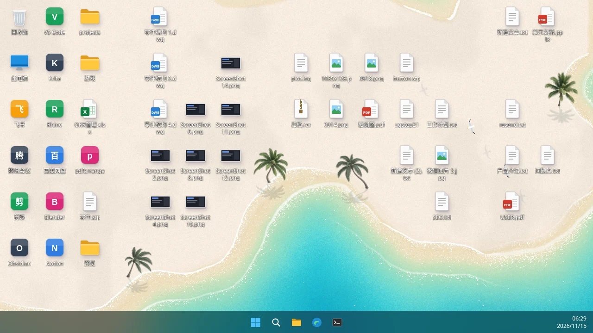

# DiyarDesk

**Adaptive desktop wallpaper that makes your desktop icons part of the scenery.**

DiyarDesk turns the space around your desktop icons into a living interactive landscape on **Linux** (KDE Plasma 6, X11, wlroots Wayland), **Windows**, and **Android Tablets (`sw600dp+`)**. Move, add, or remove an icon and dunes, snow clearings, clouds, aurora glow, or ocean waves reshape smoothly around it — locally in real time, without AI, cloud accounts, or telemetry.

> **Upstream attribution:** DiyarDesk is an independent community fork based on [Deskland](https://deskland.app) (`GPL-3.0`), using its own product name (**DiyarDesk**) and original icon, with no official affiliation or endorsement from upstream Deskland. See [NOTICE](NOTICE) and [TRADEMARKS.md](TRADEMARKS.md).

**English** · [Türkçe](#türkçe) · [Download Releases](https://github.com/adam0307a/DiyarDesk/releases/latest) · [Features](#features) · [Linux Setup](#linux-setup) · [Windows Build](#windows-build) · [Android Tablets](#android-tablets-sw600dp)

<a href="https://www.buymeacoffee.com/adam0307a" target="_blank"></a>


https://github.com/user-attachments/assets/692ecb8c-af4a-4183-8e3e-d79dc563a832


https://github.com/user-attachments/assets/0be337c1-53e9-4989-a391-da87cc2528e3


https://github.com/user-attachments/assets/1b5ced02-b424-4204-97c8-ed7ba797de0c


https://github.com/user-attachments/assets/36224867-04a2-4d6a-b534-13024cdc575b


| Sahara Desert | Polar Night |
| --- | --- |
|  |  |

| Aurora Lake | Meadow & Beach |
| --- | --- |
|  |  |



## Included themes

DiyarDesk includes **13 complete adaptive/animated themes** (including **Zen Archipelago** and **Istanbul — Bosphorus Sunset**) plus custom theme import (`.zip`, `.deskland`, single `.html`, images, and videos):

- **Sahara (`desert.html`)** — overhead desert dunes with raised sunlit sand hills beneath dropped icons, date-palm oases, Bedouin tents, camels, and travelers
- **Polar Night (`polarnight.html`)** — side-view winter horizon, triple aurora curtains, shooting stars, snow forest clearing around icons, and warm shore cabin
- **Aurora (`aurora.html`)** — top-down frozen fjord, ice shimmer, aurora reflection, pine islands, and glowing lanterns
- **Meadow (`meadow.html`)** — ink-and-wash grass, icon-hugging clouds and shadows, kite boy, and black cat
- **Beach (`flat.html`)** — shoreline waves curving around icons, kayaks, seabirds, and coconut palms
- **Glade (`glade.html`)**, **Rift (`rift.html`)**, **Strike (`strike.html`)**, **Pocket (`pocket.html`)**, **Roach (`roach.html`)**, **Rosebrook (`rosebrook.html`)**

## Features

- **Adaptive scenery:** tracks live desktop icon positions (KDE Plasma `IconSpy`, GVfs/Xfce, or Windows Shell) and updates smoothly when icons move.
- **Custom theme importer:** import `.zip`/`.deskland` theme packs, standalone `.html` shaders/pages, images, or looping videos directly from Settings (`+ Import theme…`), with built-in format help (`?`).
- **Desktop integration:** system tray menu, session autostart, and automatic pause when a foreground window is maximized or fullscreen.
- **Private sharing:** snapshots and animation exports render sample icons cleanly without exposing your personal files or desktop names.
- **Offline & private:** no accounts, telemetry, store APIs, or auto-updater endpoints.

## Linux Setup

Prebuilt packages (`.deb`, Arch `.pkg.tar.zst`, portable `.tar.gz`) are published on [GitHub Releases](https://github.com/adam0307a/DiyarDesk/releases/latest).

### Requirements (from source)

- Python `>= 3.10`, `python3-gi`, `python3-gi-cairo`, GTK 3 (`gir1.2-gtk-3.0`), WebKit2GTK (`gir1.2-webkit2-4.1` or `4.0`), AppIndicator3 (`gir1.2-ayatanaappindicator3-0.1`).
- Optional: `gir1.2-gtklayershell-0.1` (Sway/Hyprland), `xdotool` (X11 fullscreen detection), KDE Plasma 6 WebEngine/IconSpy plugins (`linux/plasma-wallpaper/`, `linux/kde-iconspy/`).

### Run & test from source

```bash
./linux/run.sh

# Run Python unit tests
PYTHONPATH=linux uv run --with pytest pytest -v linux/tests
```

User settings, imported themes, custom audio files, and logs are stored in `~/.config/deskland/`.

## Browser preview

```bash
node prototype/serve.mjs
```

Open **http://localhost:5178/settings.html** (`?lang=en`). Browser preview uses sample icons; real desktop icon tracking runs under the Linux or Windows host.

## Windows Build

Prebuilt x64 NSIS installers are published on [GitHub Releases](https://github.com/adam0307a/DiyarDesk/releases/latest). To build locally in PowerShell:

```powershell
powershell -ExecutionPolicy Bypass -File host\build.ps1
host\bin\Deskland.exe
```

To build the NSIS installer (`dist/`):

```powershell
powershell -ExecutionPolicy Bypass -File tools\build-installer.ps1
```

## Android Tablets (`sw600dp+`)

DiyarDesk includes a native **Android Tablet** live wallpaper companion (`android/`, targeting `requiresSmallestWidthDp="600"` and Android 10+ / API 29+):

- **Designed for tablets only:** declares `<supports-screens android:requiresSmallestWidthDp="600" ... />` so phone layouts and small batteries are not targeted, while tablet widescreens match DiyarDesk's desktop proportions and pause WebGL/Canvas rendering automatically whenever the home screen is not visible.
- **Interactive Icon & Widget Layout Editor:** position where your launcher icons and widgets sit (`4×5`, `5×6 Tablet`, drag-and-drop icons & widgets) so every adaptive scene wraps cleanly around your Android launcher grid.
- **Shared settings & custom theme import:** hosts `prototype/settings.html` natively with Document Picker import (`.zip`, `.deskland`, `.html`, images, videos) and PNG snapshot saving to `Pictures/DiyarDesk`.
- **Build & test from source:** `gradle --project-dir android testDebugUnitTest assembleDebug` (also built automatically in GitHub Actions `.github/workflows/build-android.yml`).

## Project layout

| Path | Contents |
| --- | --- |
| `linux/deskland_linux/` | Modular Python Linux host, tray, fullscreen pause, icon readers, custom theme importer |
| `linux/plasma-wallpaper/` | KDE Plasma 6 native WebEngine wallpaper plugin |
| `linux/kde-iconspy/` | KDE Plasma companion helper for live desktop icon coordinates |
| `linux/packaging/` | Desktop entry, original DiyarDesk SVG icon, `.deb` and Arch `PKGBUILD` scripts |
| `host/` | Windows C#/WinForms/WebView2 host and build scripts |
| `android/` | Native Android Tablet (`sw600dp+`) Kotlin `WallpaperService`, icon/widget layout editor & Settings host |
| `prototype/` | Shared themes, settings UI (`settings.html`), i18n JSONs (`en`, `zh-CN`), sharing script, assets |
| `tools/` | Version metadata and Windows NSIS installer scripts |

## Credits and license

Source code and included theme assets are licensed under [GPL-3.0](LICENSE). Third-party dependencies retain their own licenses; see [THIRD_PARTY_NOTICES.md](THIRD_PARTY_NOTICES.md), [NOTICE](NOTICE), and [TRADEMARKS.md](TRADEMARKS.md).

## Support

If you enjoy DiyarDesk, you can support its development:

<a href="https://www.buymeacoffee.com/adam0307a" target="_blank"></a>

---

## Türkçe

[English](#diyardesk) · **Türkçe** · [Sürümleri İndir](https://github.com/adam0307a/DiyarDesk/releases/latest)

**Masaüstü simgelerinizi manzaranın bir parçasına dönüştüren uyarlanabilir duvar kağıdı.**

**DiyarDesk**; **Linux** (KDE Plasma 6, X11, wlroots Wayland), **Windows** ve **Android Tabletler (`sw600dp+`)** üzerinde simge/widget konumlarınıza gerçek zamanlı tepki veren canlı WebGL/Canvas duvar kağıtları sunar. Bir simgeyi taşıdığınızda, eklediğinizde veya sildiğinizde kum tepeleri, kar açıklıkları, bulutlar, aurora yansımaları ya da sahil dalgaları simgelerin etrafında pürüzsüzce şekillenir. Tamamen yerel olarak çalışır; yapay zeka, hesap veya telemetri içermez.

> **Yukarı akış atfı:** DiyarDesk, [Deskland](https://deskland.app) (`GPL-3.0`) temel alınarak geliştirilen bağımsız bir topluluk çatalıdır; kendi adını (**DiyarDesk**) ve özgün logosunu kullanır, resmi Deskland sürümü veya onaylı ürünü değildir. Ayrıntılar için [NOTICE](NOTICE) ve [TRADEMARKS.md](TRADEMARKS.md) dosyalarına bakın.

### Dahili Temalar ve Özel Tema İçe Aktarma

- **13 eksiksiz dahili tema:** Sahra (`desert.html`), Kutup Gecesi (`polarnight.html`), Aurora (`aurora.html`), Çayır (`meadow.html`), Sahil (`flat.html`), Orman Açıklığı (`glade.html`), Yarık (`rift.html`), Yıldırım (`strike.html`), Cep Dünyası (`pocket.html`), Böcek (`roach.html`), Gül Deresi (`rosebrook.html`), **Zen Takımadası** (`zen-archipelago.html`) ve **İstanbul — Boğaz Gün Batımı** (`istanbul.html`).
- **Özel tema içe aktarma:** Ayarlar penceresindeki `+ Import theme…` düğmesi ve `?` biçim rehberi ile `.zip` / `.deskland` paketleri, tek dosyalı `.html` shader/sayfaları, resimler ve döngülü videolar yüklenebilir.

### Kurulum ve Çalıştırma (Linux / Kaynak Kod)

Hazır paketleri (`.deb`, Arch `.pkg.tar.zst`, taşınabilir `.tar.gz`, Windows `.exe` kurucusu ve Android Tablet `.apk`) [Releases](https://github.com/adam0307a/DiyarDesk/releases/latest) sayfasından indirebilirsiniz.

### Android Tablet Desteği (`sw600dp+`)

- Yalnızca **tablet ekranları (`requiresSmallestWidthDp="600"`, Android 10+ / API 29+)** için tasarlanmıştır; ana ekran görünür olmadığında WebGL/Canvas çizimi otomatik olarak duraklatılarak pil korunur.
- **İkon / Widget Düzenleyici:** Android başlatıcınızdaki uygulama simgelerinin ve widget'ların konumlarını seçip sürükleyerek sahil, kar, kum tepesi veya boğaz iskelelerinin ikonlarınızın etrafında şekillenmesini sağlayabilirsiniz.
- **Paylaşılan Ayar Arayüzü ve Özel Tema İçe Aktarma:** `prototype/settings.html` arayüzü ve `.zip`/`.deskland`/`.html`/görsel/video tema içe aktarma tabletlerde de doğrudan çalışır.

```bash
# Kaynaktan Linux masaüstü uygulamasını başlat
./linux/run.sh

# Python birim testlerini çalıştır
PYTHONPATH=linux uv run --with pytest pytest -v linux/tests

# Tarayıcı önizleme sunucusu
node prototype/serve.mjs
# http://localhost:5178/settings.html?lang=en
```

Kullanıcı ayarları, içe aktarılan temalar, özel ses dosyaları ve günlükler `~/.config/deskland/` dizininde saklanır.

### Windows Derleme (PowerShell)

```powershell
powershell -ExecutionPolicy Bypass -File host\build.ps1
host\bin\Deskland.exe
```

NSIS kurulum paketi üretmek için:

```powershell
powershell -ExecutionPolicy Bypass -File tools\build-installer.ps1
```

### Lisans

Kaynak kodu ve dahil edilen tema varlıkları [GPL-3.0](LICENSE) lisansı altındadır. Üçüncü taraf bileşenler için [THIRD_PARTY_NOTICES.md](THIRD_PARTY_NOTICES.md), marka kullanımı için [TRADEMARKS.md](TRADEMARKS.md) dosyalarına bakın.

### Destek

DiyarDesk'i beğendiyseniz geliştirilmesine destek olabilirsiniz:

<a href="https://www.buymeacoffee.com/adam0307a" target="_blank"></a>
